# VELOOP Rewards – Complete Level-Up Dashboard Redesign (Task 16)

> **Project:** Gamified Level Progression, Rewards & Engagement Hub  
> **Live Demo (`/Lvl-Dashboard`):** https://veloop-level-dashboard-nine.vercel.app/Lvl-Dashboard  
> **Recent Activity Route (`/Lvl-Dashboard/activity`):** https://veloop-level-dashboard-nine.vercel.app/Lvl-Dashboard/activity  
> **GitHub Repository:** https://github.com/swatu18/veloop-level-dashboard

---

## 1. Project Overview

A complete ground-up redesign and frontend implementation of the **VELOOP Rewards Level-Up Dashboard** (`/Lvl-Dashboard`), transforming the passive level page into a premium, fintech-inspired **Level-Up + Rewards + Games + Earning Hub**.

Built to faithfully match:
1. **All 6 sample UI screens** attached on Page 33 of the Task 16 assignment brief.
2. **All functionality and all 10 official winged level badges** from the reference dashboard (`ve-loop-client.vercel.app/Lvl-Dashboard`).
3. **Every technical, UX, responsiveness, and deliverable item** across Sections 1–58 of the Task 16 specification.

| Core User Question | Dashboard Implementation |
|---|---|
| **Where am I now?** | Gold Hexagon Emblem (`LEVEL 04`) + Winged Tier Badge (`Challenger`) |
| **How far have I progressed?** | Animated `6,420 XP` counter + `80%` golden progress bar (`6,420 / 8,000 XP`) |
| **What do I need next?** | Explicit `1,580 XP needed to reach Level 05` (zero mental math required) |
| **What will I receive?** | Partially-locked `Level 05 Rewards` Vault Card (`+500 VEs` & `+25 Gems`) with 3D treasure chest |
| **What level comes next?** | 10-Level Progression Roadmap (`Level 01` → `Level 10`) with `✓ Completed`, `YOU ARE HERE`, `Next Goal`, and `🔒 Locked` states |
| **What can I do right now?** | Play **XP Catcher** (20s skill game), **Mini-Games Arcade** (XOX Tic-Tac-Toe, Vault Match, 1–9 Sprint), or complete earning missions |
| **Why should I return?** | Active 7-day streaks, cooldown missions, higher tier privileges, and upcoming earning concepts |

---

## 2. Level System

- **10 Progression Tiers (`Level 01` – `Level 10`)** using all 10 official winged SVG level badges + golden padlock overlay (`src/assets/badges/lvl-1.svg` … `lvl-10.svg`, `lock.svg`):
  - `Level 01` – **Rookie** (`0 XP` · `+50 VEs`) — `✓ Completed`
  - `Level 02` – **Explorer** (`500 XP` · `+100 VEs`) — `✓ Completed`
  - `Level 03` – **Achiever** (`1,500 XP` · `+100 VEs`) — `✓ Completed`
  - `Level 04` – **Challenger** (`3,500 XP` · `+10 Gems`) — **`YOU ARE HERE`** *(Demo initial state)*
  - `Level 05` – **Ascendant** (`8,000 XP` · `+500 VEs + 25 Gems`) — **`Next Goal`**
  - `Level 06` – **Elite** (`11,000 XP` · `+2 Spins`) — `🔒 Locked`
  - `Level 07` – **Master** (`15,000 XP` · `+750 VEs + 1 SVE`) — `🔒 Locked`
  - `Level 08` – **Champion** (`20,000 XP` · `+40 Gems`) — `🔒 Locked`
  - `Level 09` – **Legend** (`26,000 XP` · `+1,500 VEs`) — `🔒 Locked`
  - `Level 10` – **Mythic** (`33,000 XP` · `+5 SVEs + 10 Tokens`) — `🔒 Locked`
- **Click-to-Inspect Level Details Sheet:** Clicking any badge in the roadmap opens its full breakdown (XP threshold, demo rewards, unlocked privileges, and a preview of the Level 05 unlock celebration).

---

## 3. XP System

- **Animated XP Counter & Golden Progress Bar:** Smoothly counts up and fills on load and after every earned reward (`6,420 / 8,000 XP · 80% · 1,580 XP remaining`).
- **Today's Boost Strip:** Live daily summary of **XP Earned (`215 XP`)**, **Tasks Done (`4 / 8`)**, and **Streak (`7 Days`)**.
- **Recent XP Activity & Sources (`/Lvl-Dashboard/activity`):** Filterable feed across `All`, `Tasks`, `Games`, `Referrals`, `Streaks`, and `Rewards`, paired with **Today's Summary** (`215 XP Total Earned` & `35 VEs Total Earned`).
- **Transparent `[i]` Tooltips:** Accessible info popovers explaining both the VELOOP level system and reward configuration.

---

## 4. Next-Level Rewards & Level-Up Celebration

- **Partially-Locked Next-Level Reward Vault:** Displays `Level 05 Rewards` (`+500 VEs` + `+25 Gems`), a 3D treasure chest with amethyst gems, animated falling coins/gems, an `[i]` reward info tooltip, and a `Reach Level 05 to unlock (1,580 XP left) · 80%` progress bar.
- **Level-Up Celebration Modal (Screen 5):** Triggers automatically when crossing a level threshold (or via `View Rewards → Preview Level 05 Unlock Celebration` or `?state=levelup`). Displays the golden `LEVEL 05` hexagon flanked by golden laurel wreaths on a 3D podium, floating V-coins & purple gems, `+500 VEs` & `+25 Gems` cards, unlocked tier privileges (`Higher daily XP limit`, `Access to new challenges`, `Better reward opportunities`), `Claim Rewards` CTA, and **Reward Confetti Rain**.

---

## 5. Game Concept – XP Catcher & Mini-Games Arcade

- **Mandatory Play & Earn Mini-Game (`XP Catcher`):** 20-second skill/engagement collector game matching Mockup Screens 2 & 3 — completely free of gambling, betting, casino, or jackpot mechanics.
- **Additional Mini-Games Arcade (`Mini Games`):** Includes **3 playable skill mini-games**:
  1. **XOX (Tic-Tac-Toe):** Gold `V` vs. Purple `XP` AI bot (`+75 XP & +15 VEs` on victory).
  2. **VE Vault Memory Match:** Match 6 pairs of 3D VELOOP tokens (`+75 XP & +15 VEs`).
  3. **1–9 Vault Number Sprint:** Tap glowing vaults `1 → 9` in order (`+60 XP & +12 VEs`).

---

## 6. Game Rules (XP Catcher)

All game mechanics and demo reward rules are transparently displayed before playing:

- **How to Play:** Move the wide 3D golden collector bowl left and right using **touch drag** (iOS/Android), **mouse drag**, or **`←` / `→` arrow keys** (`A` / `D`).
- **Objective:** Catch falling **XP Orbs**, **VE Coins**, **Emerald Gems**, and **2X Boosters** within the **20-second** timer.
- **Scoring:**
  - `VE Coin`: **+5 pts** (+VE bonus)
  - `XP Orb`: **+10 pts**
  - `Emerald Gem`: **+15 pts**
  - `🚀 2X Booster`: Doubles points for **5 seconds**
- **Demo Reward Tiers** *(development/demo values clearly separated from backend logic in `src/services/rewardService.js`)*:
  - Score `90+` → **+30 XP & +12 VEs** (*Outstanding!*)
  - Score `60–89` → **+20 XP & +5 VEs** (*Great Job!*)
  - Score `30–59` → **+10 XP & +2 VEs** (*Nice Work!*)
  - Score `0–29` → **+5 XP** (*Good Try!*)
- **Eligibility & Play Limit:** Open to all VELOOP users; `5` daily skill runs tracked with unlimited demo replays.

---

## 7. Earning Features

- **Interactive Earning Flows:**
  - **Watch & Earn (`+50 XP & +5 VEs`, 5h cooldown):** Built-in responsive sample promotional video player with countdown timer & reward unlock.
  - **Daily Missions / Daily Tasks (`+30 XP & +5 VEs`, 24h cooldown):** Interactive 3-step mission checklist modal.
  - **Refer & Earn (`+100 XP & +15 VEs`, 2h cooldown):** Personal referral code (`VELOOP-7749`), one-click Copy Link, direct friend invite, and WhatsApp/Telegram sharing.
  - **XP Catcher (`+30 XP & +12 VEs`):** Launches the 20s collector game.
  - **Mini Games (`+75 XP & +15 VEs`):** Launches XOX Tic-Tac-Toe, VE Vault Memory Match & 1–9 Sprint.
  - **Streak Bonus (`+25 XP & +10 VEs`, 24h cooldown):** Interactive 7-Day Streak Check-In modal.
  - **Daily Challenge (`+50 XP`), Weekly Quest (`+200 XP`), & Quick Quiz (`+40 XP`):** Claimable challenges and 3-question trivia modal.
- **Upcoming Concepts Clearly Marked `Coming Soon` (PDF §23 & §47):**
  - **Reward Hunt** (`Up to +120 XP` · *Coming Soon*)
  - **Bonus Missions** (`Up to +150 XP` · *Coming Soon*)
- **Dynamic "Recommended for You" Banner:** Adapts its CTA based on remaining XP to the next level.

---

## 8. Technology Stack

- **React.js 18** (Functional components, React Hooks, Context API)
- **Vite 5** (Development server & optimized production bundling)
- **Bootstrap 5** (`bootstrap/dist/css/bootstrap.min.css` reboot & responsive utilities)
- **CSS Modules (`.module.css`)** + Design Tokens (`#161827` project-wide body background)
- **React Router DOM v6** (`/Lvl-Dashboard` & `/Lvl-Dashboard/activity` + `vercel.json` / `_redirects` SPA rewrites)
- **Lucide React** & **React Icons** (`react-icons/fa`)
- **HTML5 Canvas** (`ConfettiRain` 60fps celebration effect) + custom 3D WebP & SVG assets

---

## 9. Installation

```bash
# Clone the repository
git clone https://github.com/swatu18/veloop-level-dashboard.git
cd veloop-level-dashboard

# Install dependencies
npm install
```

---

## 10. Development Commands

```bash
# Start local development server (http://localhost:5173/Lvl-Dashboard)
npm run dev

# Build optimized production bundle
npm run build

# Preview production build locally
npm run preview
```

---

## 11. Folder Structure

```text
veloop-level-dashboard/
├── docs/
│   └── screenshots/            # Real captured screenshots across viewports & states
├── public/
│   ├── _redirects              # Netlify SPA route rewrite
│   └── favicon.svg
├── src/
│   ├── assets/
│   │   ├── badges/             # 10 official winged SVG level badges (lvl-1..10.svg) + lock.svg
│   │   └── illustrations/      # 3D transparent WebP assets (chest, trophy, podium, coins, gems, basket, wallet, icons)
│   ├── components/
│   │   ├── BottomNav/          # Persistent bottom tab navigation (Home, Earn, Rewards, Wallet, Profile)
│   │   ├── ConfettiRain/       # 60fps Canvas Reward Confetti Rain effect
│   │   ├── CurrentLevel/       # Gold Hexagon Level badge + animated XP hero card
│   │   ├── EarnMoreXP/         # QuickEarnGrid, Action Hub, & global Screen 4 EarnDrawer
│   │   ├── GameTokens/         # 3D WebP & specular SVG tokens (XpOrb, VeCoin, GemToken, GraphicIcon)
│   │   ├── InteractiveModals/  # Watch Video, Daily Missions, Refer & Earn, XOX/Memory/Sprint, Streak, Quiz
│   │   ├── LevelDetailsSheet/  # Click-to-inspect level details & Level 05 unlock preview
│   │   ├── LevelHero/          # Top header bar, greeting & wallet balance pill
│   │   ├── LevelInfo/          # Accessible [i] info tooltip component
│   │   ├── LevelRewardCard/    # Individual roadmap badge node (Completed/Current/Next/Locked)
│   │   ├── LevelRoadmap/       # 10-Level progression & rewards roadmap
│   │   ├── LevelUpModal/       # Screen 5 Level-Up celebration modal with golden laurels & podium
│   │   ├── NextLevelReward/    # Partially-locked Level 05 reward vault with falling coin shower
│   │   ├── PlayAndEarn/
│   │   │   ├── GameContainer/  # Global GameModal + inline GameStart orchestration
│   │   │   ├── GameStart/      # Inline XP Catcher promo, rules & unavailable empty state
│   │   │   ├── GamePlay/       # Screen 2 zero-lag 60fps gameplay arena
│   │   │   ├── GameResult/     # Screen 3 Challenge Complete trophy & score screen
│   │   │   └── Game.module.css
│   │   ├── Recommendation/     # Dynamic "Recommended for You" CTA banner
│   │   ├── Skeletons/          # Shimmer loading skeletons for all 6 dashboard sections
│   │   ├── States/             # Friendly ErrorState component
│   │   ├── TabViews/           # Dedicated WalletView & ProfileView components
│   │   ├── TodayBoost/         # Today's Boost (XP Earned, Tasks Done, Streak)
│   │   ├── XPActivity/         # Screen 6 Recent Activity feed + Today's Summary + Empty State
│   │   └── XPProgress/         # Animated golden XP progress bar
│   ├── context/
│   │   └── DashboardContext.jsx
│   ├── data/                   # Decoupled demo configuration (levels, user, earnings, activity, game.config)
│   ├── hooks/                  # useCooldown, useCountUp
│   ├── pages/
│   │   ├── ActivityPage/       # /Lvl-Dashboard/activity
│   │   └── LevelDashboard/     # /Lvl-Dashboard
│   ├── services/               # Decoupled levelService & rewardService (ready for backend API swap)
│   └── styles/                 # tokens.css (#161827 body) & global.css
├── index.html
├── package.json
├── vercel.json                 # Vercel SPA rewrite ensuring /Lvl-Dashboard never 404s
└── vite.config.js
```

---

## 12. Component Architecture

- **Clean Separation of Concerns:**
  - `src/data/` isolates level thresholds, rewards, earning items, and game rules from UI components (PDF §50).
  - `src/services/levelService.js` and `src/services/rewardService.js` isolate mock/demo data fetching and reward calculation from UI state so backend APIs can drop in cleanly without refactoring components (PDF §7, §44).
  - `src/context/DashboardContext.jsx` manages central progression state, `localStorage` persistence, cooldowns, level-up detection, and confetti triggers.
  - Global modals (`EarnDrawer`, `GameModal`, `LevelUpModal`, `LevelDetailsSheet`, and interactive earning modals) are mounted at page root so navigation works seamlessly from any tab or route.

---

## 13. Responsive Behavior

- **Mobile (`320px+` — iOS Safari & Android Chrome):** Uses `100dvh`, `viewport-fit=cover`, and `env(safe-area-inset-*)` for iPhone notches and Android gesture bars, touch-drag game controls, horizontal swipeable Level Roadmap, and a fixed 5-tab Bottom Navigation Bar.
- **Tablet (`768px+`):** Expanded header controls, full Today's Boost & Earn More layouts, and readable card spacing.
- **Laptop, Desktop & Large Screens (`1280px+`, `1440px+`, `1920px+`):** Multi-column fintech dashboard composition (Hero + Next Reward, 5×2 Level Roadmap grid, side-by-side Arcade + Activity, and Action Hub with 3-column interactive cards) with a floating centered bottom dock.

---

## 14. Animation Details

- **Subtle Fintech-Grade Motion** (respects `prefers-reduced-motion: reduce`):
  - Smooth XP bar fill + gold light sweep on page load (`XPProgress`).
  - Numeric count-up interpolation (`useCountUp`) on XP, remaining XP, Today's XP, and Game Final Score.
  - Animated golden coins & amethyst gems falling into the Next-Level Reward chest and flowing into the Action Hub treasure wallet.
  - Zero-lag direct-DOM `requestAnimationFrame` collector tracking with vertical neon-gold/purple/emerald light trails and ambient bokeh orbs in XP Catcher.
  - 60fps HTML5 Canvas **Reward Confetti Rain** on game completion, reward claims, and Level-Up.

---

## 15. Screenshots

### Desktop Level Dashboard (`1440px`)
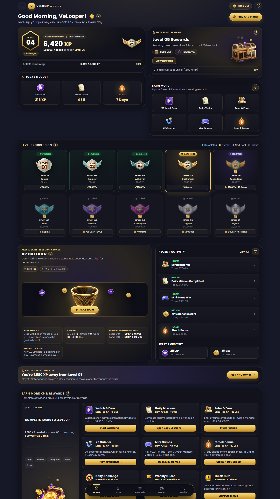

### Tablet Version (`768px`)
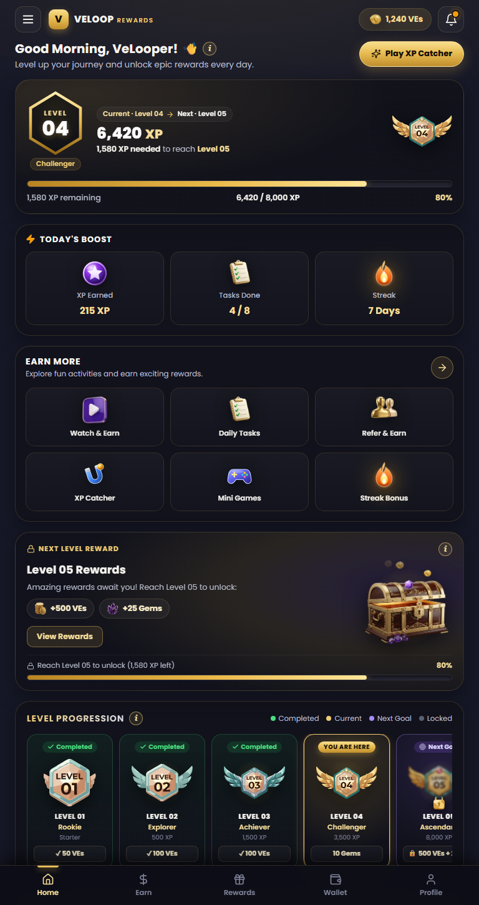

### All 6 Sample Screens (Mobile, Game, Earn, Level-Up & Activity)
| Screen 1 – Mobile Home | Screen 2 – XP Catcher Gameplay | Screen 3 – Challenge Complete |
| :---: | :---: | :---: |
| 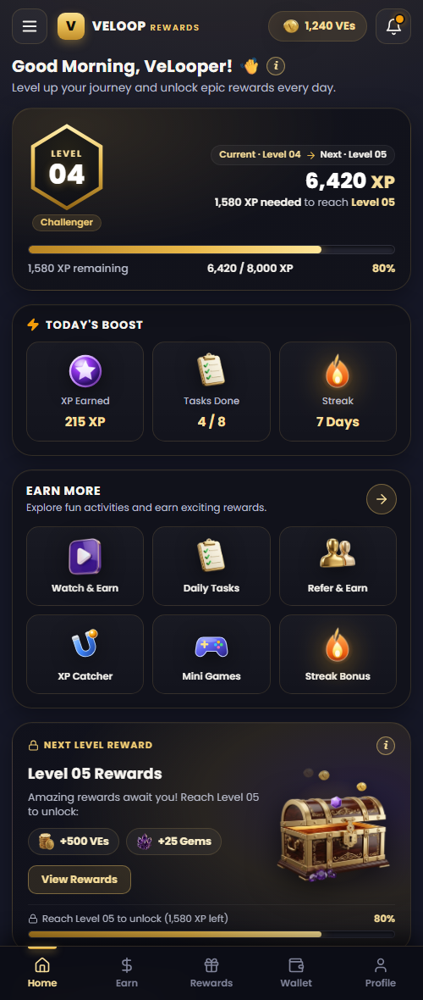 | 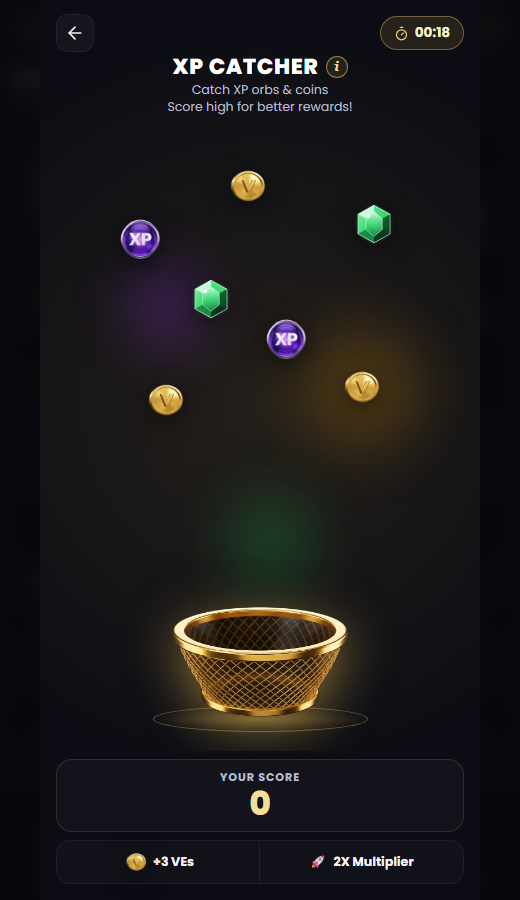 | 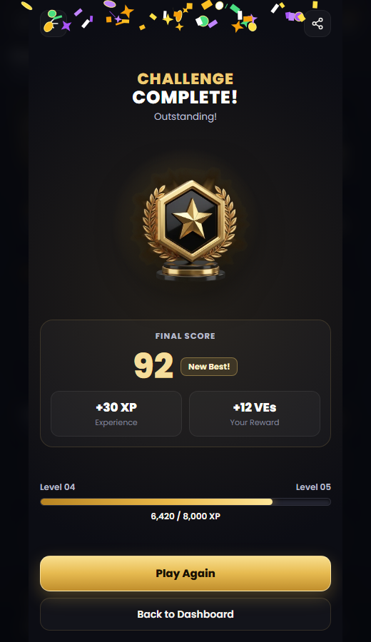 |

| Screen 4 – Earn & Level Up | Screen 5 – Level-Up Celebration | Screen 6 – Recent Activity |
| :---: | :---: | :---: |
| 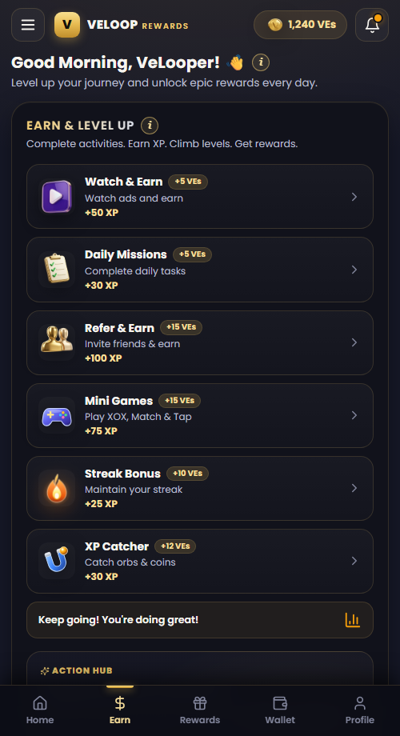 | 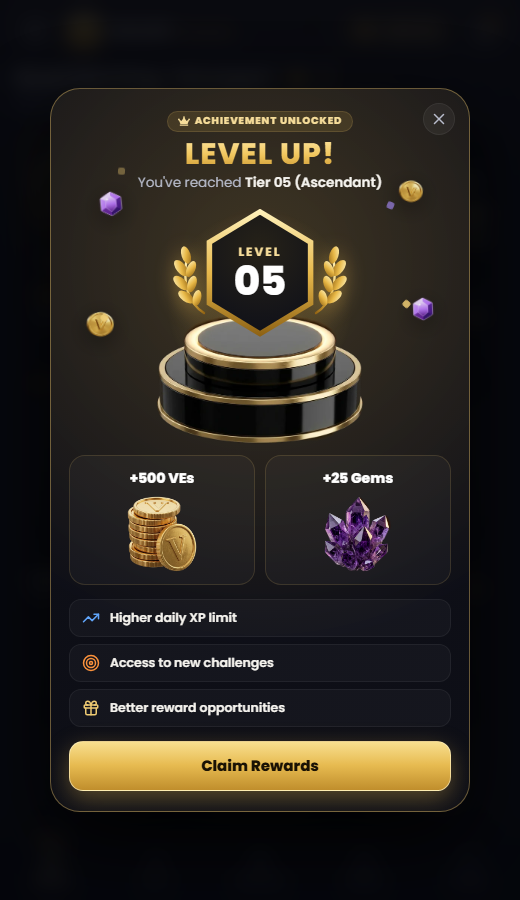 | 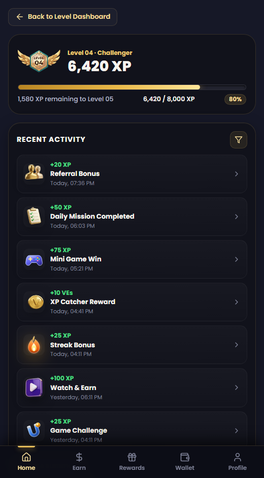 |

### Wallet View (`?tab=wallet`)
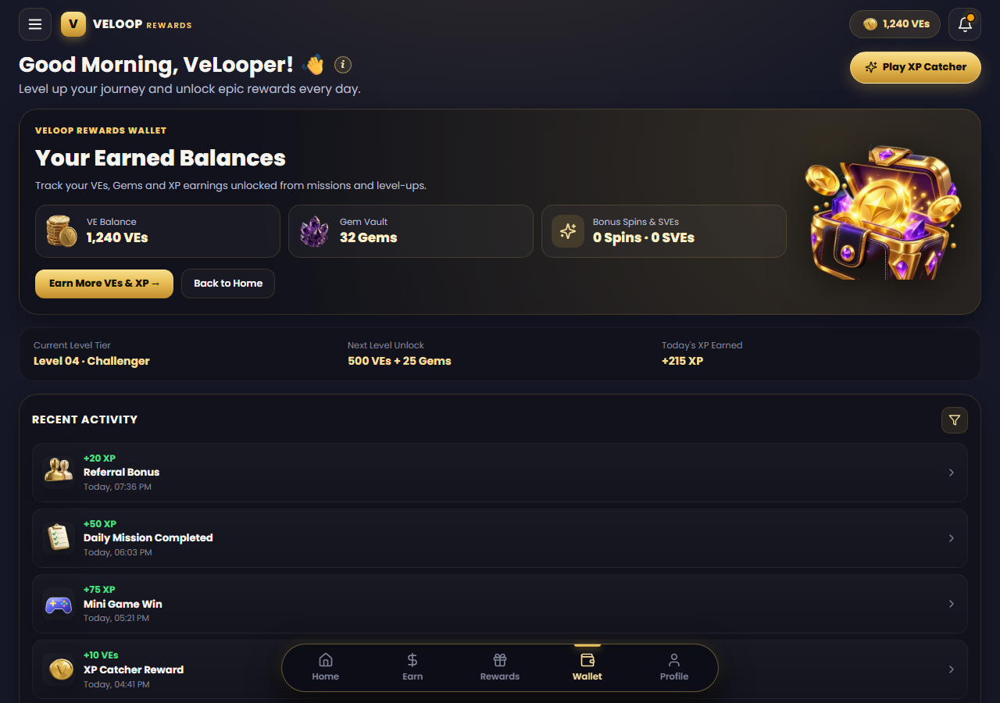

### UX States (Loading, Empty & Friendly Error)
| Skeleton Loading State (`?state=loading`) | Friendly Error State (`?state=error`) |
| :---: | :---: |
| 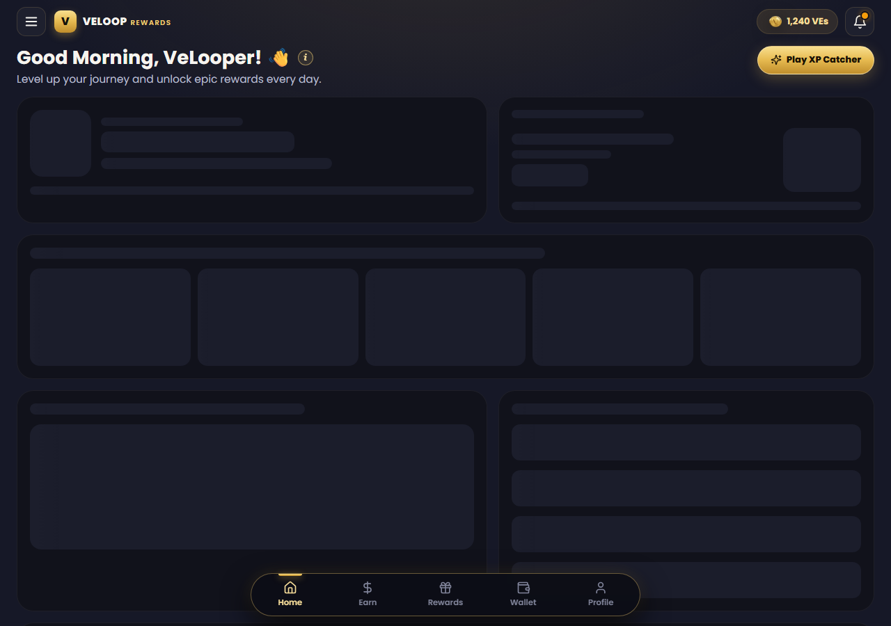 | 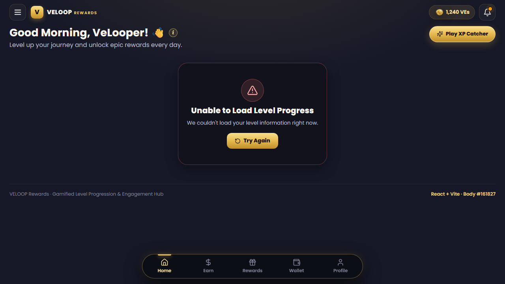 |

### Empty States – No Available Game & No XP Activity (`?state=empty`)
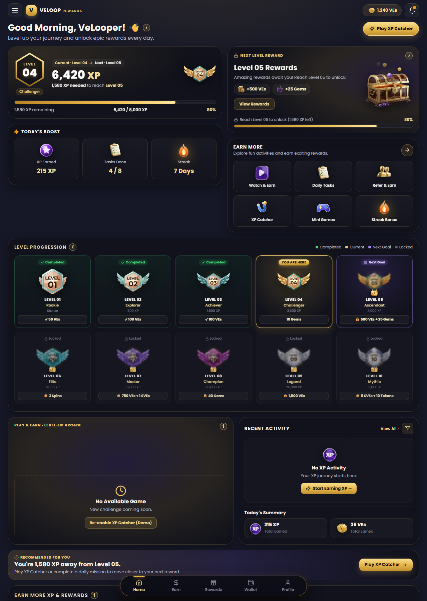

---

## 16. Live Demo & Reviewer Quick-Preview URLs

- **Main Level-Up Dashboard:** https://veloop-level-dashboard-nine.vercel.app/Lvl-Dashboard
- **Recent XP Activity Page:** https://veloop-level-dashboard-nine.vercel.app/Lvl-Dashboard/activity
- **Quick-Preview Reviewer Links** *(to inspect every UX state in 1 click without cluttering the UI)*:
  - Level-Up Celebration (Screen 5): `https://veloop-level-dashboard-nine.vercel.app/Lvl-Dashboard?state=levelup`
  - XP Catcher Result (Screen 3): `https://veloop-level-dashboard-nine.vercel.app/Lvl-Dashboard?game=result`
  - Skeleton Loading State: `https://veloop-level-dashboard-nine.vercel.app/Lvl-Dashboard?state=loading`
  - Empty Activity & Unavailable Game State: `https://veloop-level-dashboard-nine.vercel.app/Lvl-Dashboard?state=empty`
  - Friendly Error State: `https://veloop-level-dashboard-nine.vercel.app/Lvl-Dashboard?state=error`

---

## 17. GitHub Repository

- **Repository URL:** https://github.com/swatu18/veloop-level-dashboard

---

## 18. Author

- **Name:** SWATHI G
- **Intern ID:** VLRINT202603048
- **Domain:** Frontend Development Intern
- **Project:** Task 16 – VELOOP Rewards Complete Level-Up Dashboard Redesign
- **GitHub:** [@swatu18](https://github.com/swatu18)
